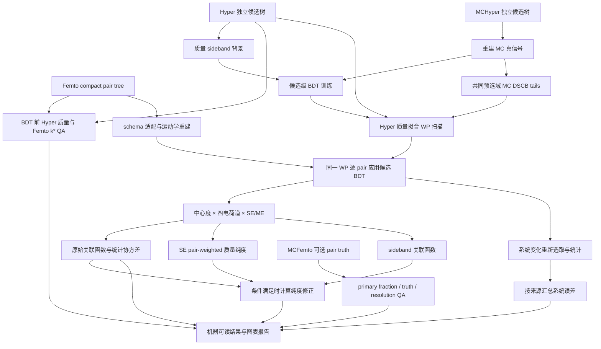

# 框架设计与扩展

本项目将 π–H3L femtoscopy 的输入适配、候选分类、pair 统计、物理修正和执行记录拆开，形成可配置、可复跑、可检查的离线分析工程。统一配置承载分析选择，数值模块处理数组和 histogram，执行层组织阶段与产物，报告层展示结果及缺失信息。

## 数据流

训练与 Femto 输入在对象层面分开。训练使用独立候选树；Femto 直接在每行的候选变量上推理。不额外追踪 hypertriton ID，也不构造候选指纹。

## 分层职责

| 层 | 责任 | 设计边界 |
| --- | --- | --- |
| 配置 | 默认值、用户覆盖、物理区间、训练选项、系统变化 | 错误字段或不支持的方法应尽早失败 |
| Schema / I/O | ROOT 树发现、branch 映射、必要字段、分块读取 | producer 字段命名只在这一层适配 |
| 运动学 | 四动量、质量、ct、cosPA、k*、ITS 解码 | 不依赖 CLI 或输出目录 |
| 原始 QA | Hyper 独立候选质量；Femto k* 按中心度 × 四道 × SE/ME 分组 | 不经过 preparation、BDT 或分析 cuts，不去重 ID |
| 选择 | 候选、关联 pion、事件、BDT、CPR 选择及 cutflow | 名义分析、系统变化和 MC 使用同一套逻辑 |
| 训练 | 标签构造、样本划分、BDT、训练 QA | 不读取 pair pion、ct 或 truth 作为模型特征 |
| 工作点 | MC DSCB tails、Hyper DSCB + pol1/pol2 质量拟合、3σ raw/eff pol0、expected significance 与阈值选择 | 不读取 Femto pair，不以 MC efficiency 直接充当最终 WP |
| 统计 | SE/ME histogram、归一化、关联函数、误差 | 保留空 bin、invalid mask 与数值状态 |
| 物理修正 | 质量纯度、sideband 扣除与传播 | 缺少输入时明确不可计算，不生成伪修正 |
| MC QA | reconstructed pair 样本的 fraction 与真值诊断 | 不把有限 pair tree 当作完整生成分母 |
| 系统研究 | 配置覆盖、重跑变化、按来源组合 | 每个变化保留自己的结果与接受情况 |
| ROOT 图形与报告 | PyROOT 对象/canvas、ROOT 文件、PDF、HTML 索引 | 绘图使用数值产物，保留 sumw2、无效状态和协方差 |
| 执行 | 阶段依赖、provenance、写锁、事务式输出 | 可追踪配置、数据和模型如何产生结果 |

## 为什么采用统一内部列名

新版 pair tree 的候选变量以 `fHyp` 开头，独立候选树以 `f` 开头，关联 pion 变量以 `fHad` 开头。它们在适配层转换成共享的候选列和独立的 pair-pion 列。这样 BDT 和运动学只需实现一次，MC 与数据也可共用选择逻辑。

增加一个字段应先回答三个问题：输入树是否真正保存它，它是 candidate/event/pair 的哪一层属性，以及该字段在训练与应用端是否同时可得。通过这些检查后，再扩展 schema 和配置；不要在不同分析阶段各写一套隐式字段别名。

## 计算规模

pair 数量可能比候选数量大数个数量级。ROOT 读取按 chunk 执行，模型推理和 histogram 聚合也应以 chunk 为单位。调整 chunk 大小改变内存/吞吐，不应改变物理结果。独立候选训练样本的上限用于限制模型训练规模，应记录原始可用样本量、实际使用样本量及抽样种子。

`training_qa.py` 调用 HIPE4ML plot_utils 保存 PDF 和数值 ROOT，`working_point_qa.py` 保存 PyROOT ROOT/PDF。`wp_mass_fit.py` 封装 RooFit DSCB/Chebychev 和可复读的物理计数协方差；`working_point.py` 管理有界 histogram 扫描与单一 pol0/3σ WP 选择。report 链接 ML PDF，复制当前 WP 的四个已保存 canvas 并导出同步 PDF，不重新执行训练或质量拟合。`efficiency.py` 集中调用 HIPE4ML 并记录版本、数值重试和效率接受约定。

默认以 `RootDataset` 分块读取训练/WP/pair，不保存 prepared 表。`scored_storage` 写出按系统范围裁剪的必要列；按 pT 训练时使用模型子目录。中间 scored 产物将 ROOT 解码/推理与可重复的分析变化分开，详见 [持久化契约](scored_storage.md)。缓存是否可复用取决于数据、schema、运动学、特征、模型和选择的依赖关系；仅仅“文件存在”不能证明缓存适用。

## Provenance 与状态

每次分析应保留解析后的配置、输入清单、模型特征和工作点、阶段状态及最终数值。文件路径和修改时间能识别一般输入变动；要求字节级数据验证时使用内容 hash。模型文件与依赖版本也应保留，避免仅凭随机种子声称跨版本完全复现。

分析状态与程序状态是两件事。程序可以成功输出“这个中心度/电荷道没有可归一化的 ME”或“缺少 sideband”；这些属于正确表达数据限制。程序失败则表示输入契约、依赖或计算过程不成立，需要修复后再运行。

推荐查看顺序是：阶段是否成功、8 个中心度/电荷道是否齐全、各个数值状态是否有效、QA 是否支持物理解释。只查看命令 exit code 或最后一张图不能替代这一过程。

结果接口将 nominal 统计信息与配置系统误差分开保存。系统阶段的 `final_observables.csv` 把 raw/corrected central value、stat/syst/total 与有效标志对齐到同一 bin；NPZ 保留系统和合计矩阵。训练接口保留固定 held-out MC 效率分母与密集阈值数组；训练不分中心度，Femto histogram 按中心度分组。

汇总可视化经过 `root_output.py`：读取已有数值产物，组织 ROOT 目录与 TCanvas，并通过 `root_io.py` 的 `RootArchive` 保存 histogram、graph、TH2 covariance、有效标志与 JSON 文本对象。`report/analysis.root` 和 PDF 来自同一套 ROOT 对象；`report.py` 只负责可读索引和 PDF 展示。HIPE4ML ModelHandler 管理训练/推理/保存，ML QA 使用其官方 Matplotlib 封装；WP RooFit、独立 SciPy pair-purity fitter 与物理 ROOT 绘图各自封装。对象生命周期及有效 bin 的约定见 [ROOT 输出](root_output.md)。

## 扩展路径

**新增 cut 或系统变化。** 若字段已经保存在 scored 数据中，优先通过配置加入选择与变化；新物理算法才应修改实现。每个 variation 保留可比较的中心度与 k* binning。

**接入 MCFemto。** 将文件放入配置指定的数据源，先检查 schema，再使用与数据一致的 BDT 和选择。fraction 的 numerator/denominator、SE/ME 和 k* 依赖都应能从产物中解释。

**独立 pT 模型。** `models.py` 已实现共享模型限制范围、独立 pT bin 模型、逐模型 WP/QA 和局部重训。阶段与逐模型分数缓存由 `execution.py`、`pipeline.py`、`score_cache.py` 管理，详见 [执行模式](performance.md)。中心度独立模型及同一区间多个训练定义的模型族仍属于后续扩展；各分区需要独立训练样本和物理闭合性检查。

**更完整的不确定度。** 当前 compact schema 没有事件身份。事件级 covariance、run-by-run mixing 或重建 mixing pool 需要额外输入或者上游产物，不能在离线凭空恢复。

**FSI/source 模型拟合。** 框架输出的是关联函数及其不确定度；若进一步提取 source radius、scattering 参数或物理 λ，应增加明确的理论模型、分辨率/残余相关处理、拟合范围与 covariance 使用约定。不能把质量纯度或某个低 k* bin 的数值直接命名为最终物理“关联强度参数”。

## 与已有 H3L 框架的关系

参考了相邻维护中的 `H3l_2body_spectrum/ROOTWorkFlow/CodeSpace` 所采用的统一入口、配置分区、分析 DAG、阶段 manifest 和分级验证思想。这里的目标是 pair femtoscopy，而原框架主要处理 spectrum/lifetime；因此本项目独立实现清晰的数据接口和统计链条，不依赖其 ROOT 全局状态或大型 dispatcher。

原框架的 absorption、完整重建效率、event count 以及 spectrum 重加权模块不能未经物理论证直接乘到 CF 上。需要的修正应作为有明确输入、公式、误差和 closure 测试的模块接入。

底层 Python API 分别参考 [Uproot 官方文档](https://uproot.readthedocs.io/en/stable/basic.html) 和 [HIPE4ML ModelHandler](https://hipe4ml.github.io/hipe4ml/model_handler.html)。这些是实现接口参考；物理约定由本项目数据契约、配置与验证证据定义。
